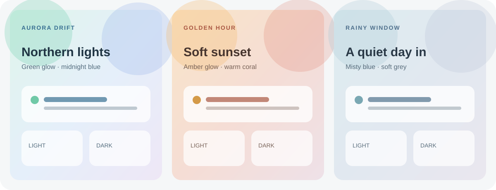
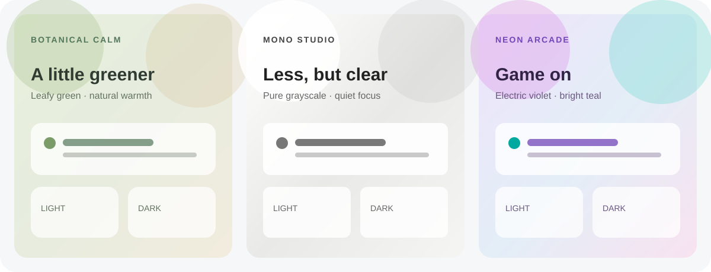

# Home Atmospheres

Seven Home Assistant dashboard themes with custom gradient wallpapers and coordinated light and dark palettes:

- **Aurora Drift** — northern-light greens and midnight blues.
- **Botanical Calm** — leafy greens and warm, natural neutrals.
- **Golden Hour** — warm amber, coral, and soft dusk.
- **Mono Studio** — a minimal, low-distraction grayscale palette.
- **Neon Arcade** — vivid violet and teal with a playful retro glow.
- **Rainy Window** — misty blue-grey for a quiet, overcast feel.
- **Quiet Horizon** — the original teal, blue, and peach palette.





These are palette mockups, not screenshots captured from Home Assistant. The wallpapers use CSS gradients only: no remote images, custom cards, extra frontend plugins, or network requests.

## Install with HACS

1. In HACS, open **Frontend** and search for **Home Atmospheres**.
2. Download the theme and restart Home Assistant, or reload themes from **Developer tools → Actions** using `frontend.reload_themes`.
3. Open your user profile, choose one of the seven themes, and select the light, dark, or system appearance.

If the themes do not appear, make sure your `configuration.yaml` includes:

```yaml
frontend:
  themes: !include_dir_merge_named themes
```

Add this only if your configuration does not already load the `themes` directory, then restart Home Assistant. You can also install this repository as a HACS custom repository of type **Theme**.

## Background behavior

The dashboard wallpapers are generated by CSS gradients in the theme file. They do not use remote images or files in `/local/`. A background explicitly set on a dashboard or view takes priority over the theme wallpaper.

The themes use standard Home Assistant frontend variables and the built-in `modes` setting, so their light and dark palettes follow the selected appearance. Some component-specific colors may still use their own defaults. These themes do not change card layouts.

## Nederlands

Zeven Home Assistant-dashboardthema's met kleurverlopende achtergronden en bijpassende lichte en donkere kleuren:

- **Aurora Drift** — noorderlichtgroen en nachtblauw.
- **Botanical Calm** — bladgroen en warme, natuurlijke neutrale tinten.
- **Golden Hour** — warm amber, koraal en zachte avondkleuren.
- **Mono Studio** — een minimalistisch grijstintenpalet dat weinig afleidt.
- **Neon Arcade** — levendig violet en teal met een speelse retro-uitstraling.
- **Rainy Window** — mistig blauwgrijs voor een rustige, bewolkte sfeer.
- **Quiet Horizon** — het originele palet van teal, blauw en perzik.

De afbeelding hierboven toont kleurimpressies, geen schermafbeeldingen van Home Assistant. De achtergronden bestaan alleen uit CSS-kleurverlopen: geen externe afbeeldingen, extra kaarten, plugins of netwerkverzoeken.

### Installeren met HACS

1. Open in HACS **Frontend** en zoek naar **Home Atmospheres**.
2. Download het thema en herstart Home Assistant, of laad thema's opnieuw via **Ontwikkelaarstools → Acties** met `frontend.reload_themes`.
3. Open je gebruikersprofiel, kies een van de zeven thema's en selecteer de lichte, donkere of systeemweergave.

Verschijnen de thema's niet? Controleer dan of `configuration.yaml` deze configuratie bevat:

```yaml
frontend:
  themes: !include_dir_merge_named themes
```

Voeg dit alleen toe als je configuratie de map `themes` nog niet inlaadt en herstart daarna Home Assistant. Je kunt deze repository in HACS ook toevoegen als aangepaste repository van het type **Theme**.

### Achtergrond en werking

De dashboardachtergronden worden met CSS-kleurverlopen gemaakt. Er worden geen externe afbeeldingen of bestanden in `/local/` gebruikt. Een achtergrond die je rechtstreeks op een dashboard of weergave instelt, heeft voorrang op de thematische achtergrond.

De thema's gebruiken standaardvariabelen van de Home Assistant-frontend en de ingebouwde instelling `modes`, zodat lichte en donkere kleuren de gekozen weergave volgen. Sommige componenten behouden mogelijk hun eigen standaardkleuren. De thema's passen geen kaartindelingen aan.

## License / Licentie

MIT. See [LICENSE](LICENSE).
