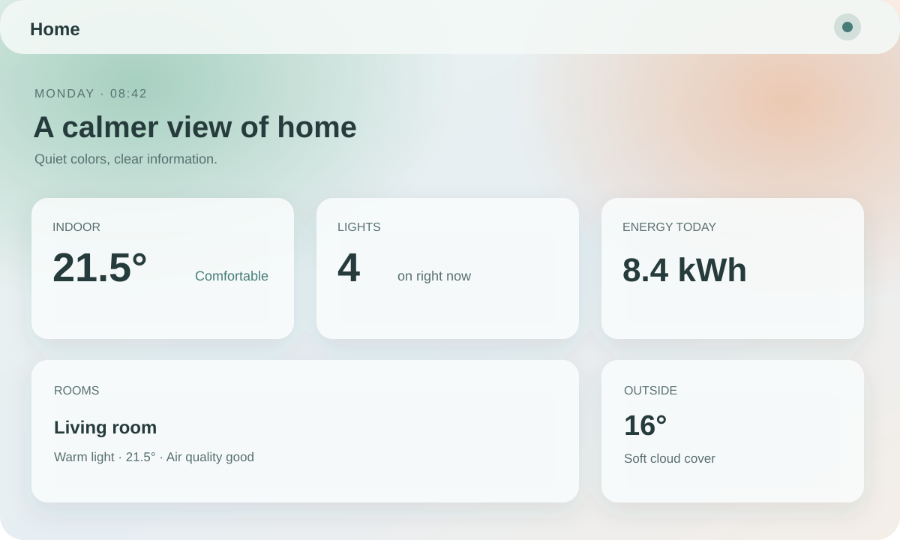
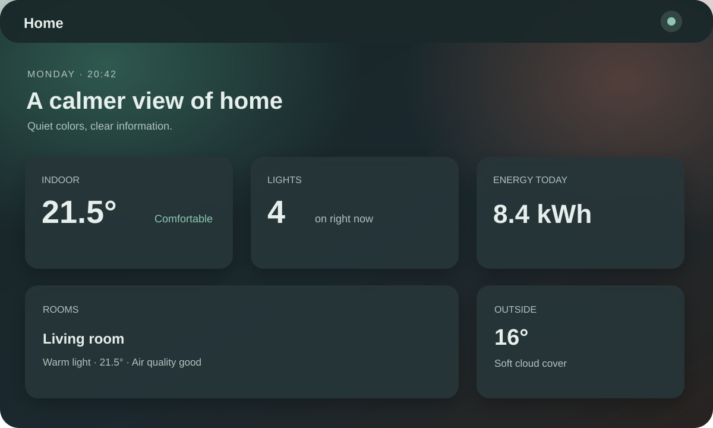

# Quiet Horizon Theme

A soft, atmospheric Home Assistant theme with a custom dashboard background and coordinated light and dark modes. It uses CSS gradients only, so it needs no external image host, extra frontend plugin, or custom card.

> The images below are palette mockups to preview the colors; they are not screenshots captured from Home Assistant.

## Preview

| Light | Dark |
| --- | --- |
|  |  |

## Install with HACS

1. In HACS, open **Frontend** and search for **Quiet Horizon Theme**.
2. Download the theme and restart Home Assistant, or reload themes from **Developer tools → Actions** using `frontend.reload_themes`.
3. Open your user profile, select **Quiet Horizon**, and choose the light, dark, or system appearance.

If you do not see the theme, make sure your `configuration.yaml` includes:

```yaml
frontend:
  themes: !include_dir_merge_named themes
```

Home Assistant creates this entry in many installations. Add it only if your configuration does not already load the `themes` directory, then restart Home Assistant.

## What it changes

- A layered, soft teal and warm peach gradient behind dashboard views.
- Coordinated light and dark palettes that follow the user's appearance setting.
- Rounded, lightly translucent cards with readable text and restrained shadows.
- Standard Home Assistant theme variables; no custom JavaScript, fonts, tracking, or network requests.

## Background behavior

The dashboard wallpaper is generated from CSS gradients in the theme. It does not use a remote image or a `/local/` file. A background explicitly set on a dashboard or view takes priority over the theme background.

## Compatibility and limits

- Designed for current Home Assistant Frontend theme support, including theme `modes`.
- Some component-specific colors may still use their own defaults.
- This theme does not change card layouts or install custom cards.

## License

MIT. See [LICENSE](LICENSE).
